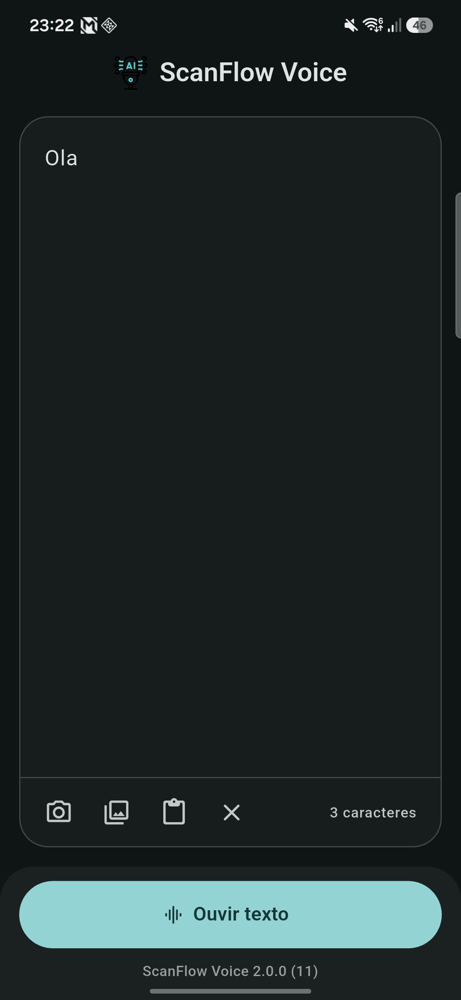

<div align="center" >


</div>

# ScanFlow Voice

ScanFlow Voice é um aplicativo móvel desenvolvido em Flutter que transforma texto em fala (Text-to-Speech) de alta qualidade. O app oferece flexibilidade permitindo que o usuário digite textos manualmente ou utilize a câmera para capturar textos de imagens e fotos através de reconhecimento óptico de caracteres (OCR).

## Funcionalidades

- **Síntese de Voz a partir de Texto:** Digite qualquer frase ou texto para convertê-lo em áudio.
- **Leitura de Imagens (OCR):** Tire fotos ou faça upload de imagens da galeria; o app extrai o texto contido na imagem e o converte em fala.
- **Vozes Realistas:** Integração com a API da ElevenLabs para gerar vozes naturais e expressivas.
- **Player:** Toque, pause e navegue pelo áudio gerado, com onda animada durante a reprodução.
- **Contador de caracteres:** Mostra o tamanho do texto, já que a ElevenLabs cobra por caractere.
- **Modo escuro:** Segue o tema do sistema.
- **Novidades:** Na primeira abertura após uma atualização, um diálogo mostra o que mudou.

## Tecnologias Utilizadas

- **Linguagem:** Dart 3.13
- **Framework:** Flutter 3.47 (canal stable)
- **IA de Voz:** ElevenLabs API (modelo `eleven_multilingual_v2`)
- **Visão Computacional:** Google ML Kit (On-device Machine Learning)
- **Gerência de estado e injeção de dependências:** GetX

## Dependências Principais

| Pacote                          | Versão    | Uso                                                                |
| ------------------------------- | --------- | ------------------------------------------------------------------ |
| `http`                          | ^1.6.0    | Requisições REST à API da ElevenLabs para síntese de áudio.        |
| `just_audio`                    | ^0.10.6   | Reprodução do áudio sintetizado recebido da API.                   |
| `google_mlkit_text_recognition` | ^0.17.1   | Reconhecimento e extração de texto em imagens, offline.            |
| `google_mlkit_commons`          | ^0.13.0   | Tipos comuns do ML Kit (`InputImage`).                             |
| `image_picker`                  | ^1.2.4    | Captura de fotos pela câmera ou seleção de imagens da galeria.     |
| `camera`                        | ^0.12.1   | Acesso às câmeras do dispositivo.                                  |
| `get`                           | ^4.7.3    | Controllers, estado reativo e navegação.                           |
| `flutter_dotenv`                | ^6.0.1    | Leitura da chave de API a partir do arquivo `.env`.                |
| `siri_wave`                     | ^2.3.1    | Animação de onda durante a reprodução do áudio.                    |
| `delightful_toast`              | ^1.1.0    | Mensagens de feedback para o usuário.                              |
| `package_info_plus`             | ^10.2.2   | Leitura da versão instalada do app.                                |
| `shared_preferences`            | ^2.5.6    | Guarda a última versão vista pelo usuário.                         |
| `pub_semver`                    | ^2.2.1    | Comparação de versões para o diálogo de novidades.                 |
| `haptic_feedback`               | ^0.8.0    | Vibração em sucessos, erros e cancelamentos.                       |

## Arquitetura e Padrões de Projeto

O projeto foi estruturado visando a manutenibilidade e a separação de responsabilidades:

```
lib/
├── main.dart                     # Inicialização, carregamento do .env e temas claro/escuro
├── changelog/changelog.dart      # Novidades por versão, mostradas após atualizar
├── components/
│   ├── asset_preloader.dart      # Pré-carrega o ícone antes do primeiro quadro
│   ├── bottom_padding.dart       # Espaço da altura da barra de navegação do sistema
│   ├── version_indicator.dart    # Versão e build do app
│   └── painters/                 # Desenho dos blocos de texto reconhecidos
├── controllers/
│   ├── home_controller.dart      # Estado da tela, OCR e reprodução de áudio
│   └── changelog_controller.dart # Diálogo "Novidades" após uma atualização
├── domain/audio/                 # Fonte de áudio em memória para o just_audio
├── screens/home_page.dart        # Editor de texto, player e botão "Ouvir texto"
└── services/
    ├── tts_service.dart          # Integração com a ElevenLabs
    └── haptics_helper.dart       # Atalhos de vibração
```

### Service Pattern (Padrão de Serviço)

A lógica de comunicação com APIs externas é isolada em classes de serviço dedicadas.

- Exemplo: `TtsService` encapsula as chamadas HTTP para a ElevenLabs, expondo apenas o método `synthesize`, que devolve os bytes do áudio.

### Organização

- **Services:** Integração com APIs externas (ex: síntese de voz).
- **Controllers (GetX):** Estado da tela e regras de negócio — OCR com ML Kit, chamada ao serviço de TTS e controle do player.
- **Screens/Components:** Camada de apresentação, responsável apenas por desenhar a tela e capturar interações do usuário.

## Preview

### Versão 2.0.0

<div>

</div>

### Versão 1.0.0

<div>


</div>

<div>


</div>

<div>


</div>

## Como Executar

### Pré-requisitos

- Flutter 3.47 ou superior (Dart 3.13)
- JDK 17 ou superior
- Android SDK com a plataforma **Android 16 (API 36)** e um **build-tools** completo (veja [Solução de problemas](#solução-de-problemas))
- Uma chave de API da [ElevenLabs](https://elevenlabs.io/)
- Um dispositivo ou emulador **Android 14 (API 34) ou superior**, ou iOS. O OCR do ML Kit não funciona na web nem no desktop

### Ambiente Android

| Item | Valor | Onde fica |
| --- | --- | --- |
| Android Gradle Plugin | 9.0.1 | `android/settings.gradle.kts` |
| Gradle | 9.2.0 | `android/gradle/wrapper/gradle-wrapper.properties` |
| Kotlin | 2.3.20 | `android/settings.gradle.kts` |
| `compileSdk` / `targetSdk` | 36 | `android/app/build.gradle.kts` |
| `minSdk` | 34 | `android/app/build.gradle.kts` |
| `applicationId` | `com.davi.dev.scanflowvoice` | `android/app/build.gradle.kts` |
| `versionName` / `versionCode` | lidos do campo `version` do `pubspec.yaml` | `pubspec.yaml` |

> A versão do AGP e a versão do Gradle são numerações diferentes. O AGP 9.0.1 precisa do Gradle 9.1 ou superior; não existe Gradle 9.0.1.

O Kotlin embutido do AGP 9 está desligado (`android.builtInKotlin=false` e `android.newDsl=false` em `android/gradle.properties`) porque o plugin `audio_session`, usado pelo `just_audio`, ainda aplica o Kotlin Gradle Plugin. Quando ele lançar uma versão compatível, remova essas duas linhas e o `id("kotlin-android")` de `android/app/build.gradle.kts`.

### Passos

1. Clone este repositório:
   ```bash
   git clone https://github.com/davigomesflorencio/scanflow_voice.git
   cd scanflow_voice
   ```
2. Crie um arquivo `.env` na raiz do projeto com a sua chave da ElevenLabs:
   ```env
   API_KEY=sua_chave_aqui
   ```
   O arquivo já está no `.gitignore` e é carregado como asset na inicialização do app.
   A chave é gerada no painel da ElevenLabs, em **Developers → API Keys** ([elevenlabs.io/app/settings/api-keys](https://elevenlabs.io/app/settings/api-keys)). Ela **começa com `sk_`** e só aparece uma vez, quando é criada ou girada. O identificador da chave mostrado na lista (uma sequência hexadecimal sem `sk_`) não funciona.

   > **Atenção:** sem o `.env` o app não compila, porque o arquivo é declarado como asset no `pubspec.yaml`. Nunca faça commit da chave real nem a coloque no README ou no código.
3. Instale as dependências:
   ```bash
   flutter pub get
   ```
4. Execute o projeto:
   ```bash
   flutter run
   ```

### Build de release (Android)

O build de release é assinado com a chave definida em `android/key.properties`. Esse arquivo e o keystore (`*.jks`) estão no `android/.gitignore` e **nunca** devem ir para o repositório.

1. Coloque o keystore em `android/app/` (ex.: `android/app/scanflowvoice.jks`).
2. Crie `android/key.properties`:
   ```properties
   storePassword=<senha do keystore>
   keyPassword=<senha da chave>
   keyAlias=<alias da chave>
   storeFile=scanflowvoice.jks
   ```
   `storeFile` é relativo a `android/app/`.
3. Gere o pacote:
   ```bash
   flutter build appbundle --release
   ```
   O arquivo sai em `build/app/outputs/bundle/release/app-release.aab`.

Sem o `android/key.properties` (por exemplo, num clone novo), o build de release continua funcionando, mas é assinado com a chave de debug, que a Play Store não aceita.

Para conferir qual chave assinou o pacote:
```bash
keytool -printcert -jarfile build/app/outputs/bundle/release/app-release.aab
```

> Guarde uma cópia do keystore e das senhas fora do projeto. Sem eles não é possível publicar atualizações do app.

### Versionamento

A versão vem do campo `version` do `pubspec.yaml`, no formato `nome+build` (ex.: `2.0.0+11`):

- `2.0.0` vira o `versionName`, a versão que o usuário vê;
- `11` vira o `versionCode`, que precisa **aumentar a cada envio** para a Play Store.

A cada nova versão:

1. Aumente o `version` no `pubspec.yaml` (ex.: `2.0.1+12`).
2. Adicione a entrada em [CHANGELOG.md](CHANGELOG.md).
3. Adicione as novidades para o usuário no mapa `_changelog` de `lib/changelog/changelog.dart`. Elas aparecem num diálogo na primeira abertura após a atualização.

### Solução de problemas

**"Não foi possível gerar o áudio"**

Quase sempre é a chave da ElevenLabs. Com o app rodando em debug, o log mostra o motivo (`Erro ao sintetizar o texto: ...`). Para testar a chave fora do app, sem gastar créditos:

```bash
curl -H "xi-api-key: $API_KEY" https://api.elevenlabs.io/v1/user/subscription
```

Se a resposta disser `API key ID used as API key`, o `.env` está com o identificador da chave e não com a chave em si. Gere ou gire a chave no painel e use o valor que começa com `sk_`. Depois de trocar o `.env`, rode `flutter run` de novo: o arquivo é empacotado no app durante o build.

**`Could not locate aapt` seguido de `Activity class {com.example.gnix_tts/...MainActivity} does not exist`**

O Flutter procura o `aapt` na versão mais alta do build-tools instalada. Se essa instalação estiver incompleta (por exemplo, uma pasta só com `.installer`), ele não lê o APK e tenta abrir o app pelo `namespace` (`com.example.gnix_tts`) em vez do `applicationId` (`com.davi.dev.scanflowvoice`). Reinstale essa versão do build-tools pelo **SDK Manager** do Android Studio ou por linha de comando:

```bash
sdkmanager "build-tools;37.0.0"
```

**`Read timed out` ao baixar de `dl.google.com`**

O Gradle não consegue baixar do repositório Maven do Google (AGP e bibliotecas Android). Não é erro do projeto. Abra a URL do erro no navegador para testar; se não carregar, verifique antivírus com análise de HTTPS, firewall, VPN ou tente outra rede.

**`Could not install Gradle distribution ... gradle-9.0.1.zip` (404)**

O Android Studio colocou a versão do AGP no lugar da versão do Gradle. Use `gradle-9.2.0-bin.zip` (ou outra versão 9.1+) em `android/gradle/wrapper/gradle-wrapper.properties`.

**Aviso `Deprecated 'org.jetbrains.kotlin.android' plugin usage`**

Esperado enquanto o Kotlin embutido do AGP 9 estiver desligado (veja [Ambiente Android](#ambiente-android)). Não impede o build.

## Changelog

O histórico de versões está em [CHANGELOG.md](CHANGELOG.md).
