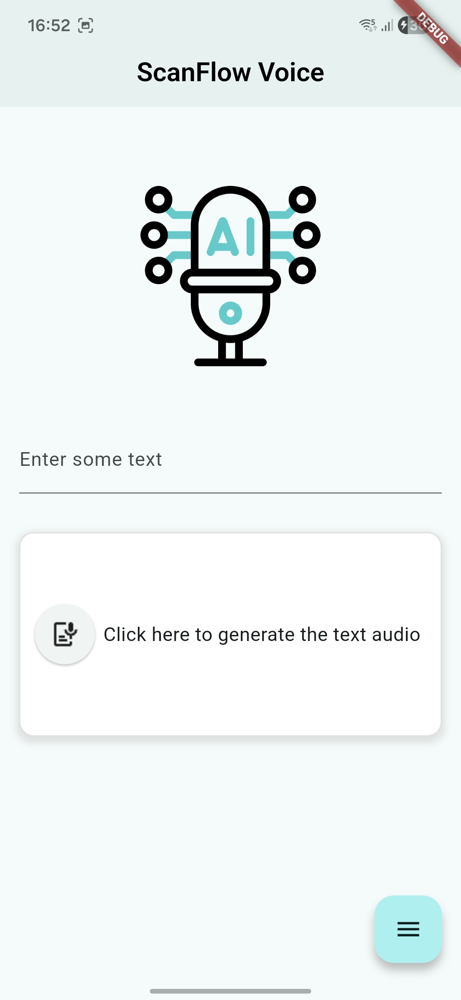
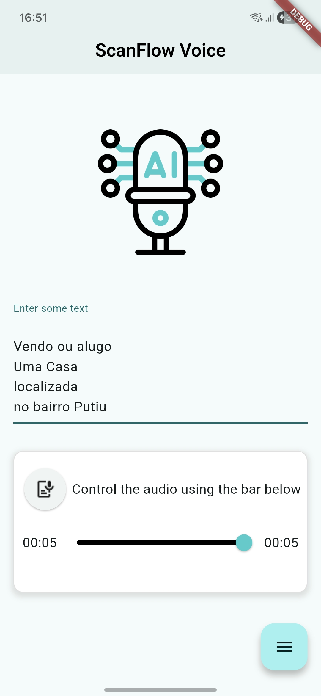
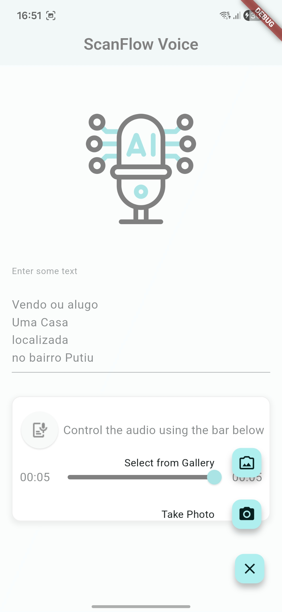
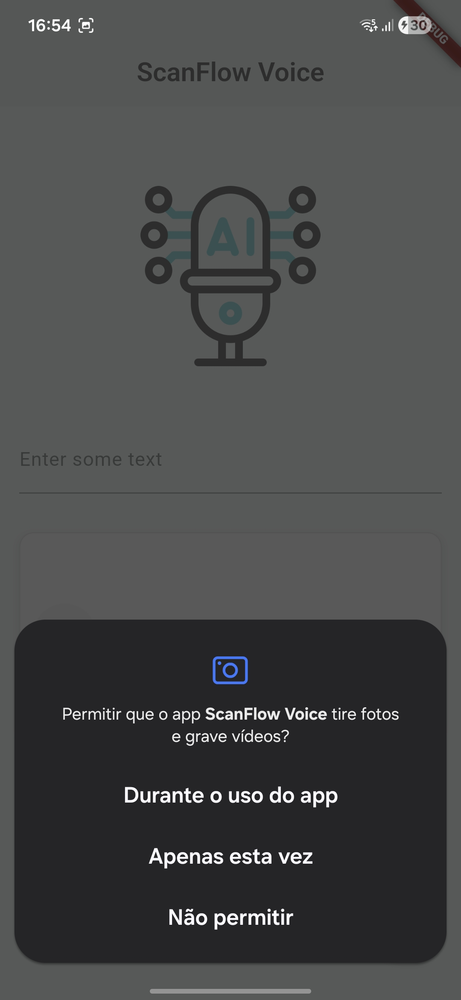
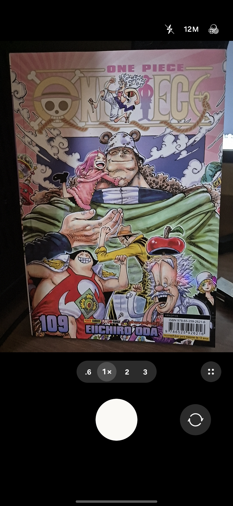
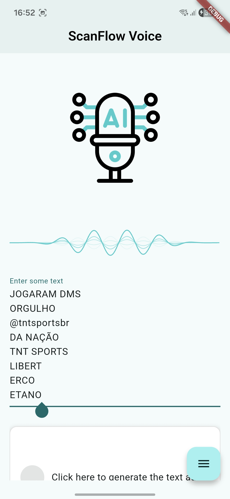
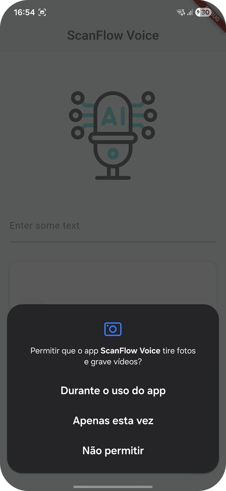
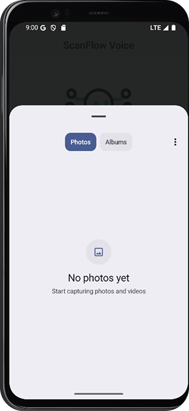
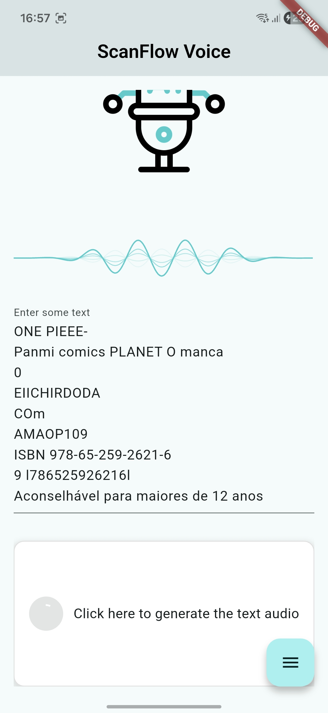

<div align="center" >


</div>

# ScanFlow Voice

ScanFlow Voice é um aplicativo móvel desenvolvido em Flutter que transforma texto em fala (Text-to-Speech) de alta qualidade. O app oferece flexibilidade permitindo que o usuário digite textos manualmente ou utilize a câmera para capturar textos de imagens e fotos através de reconhecimento óptico de caracteres (OCR).

## Funcionalidades

- **Síntese de Voz a partir de Texto:** Digite qualquer frase ou texto para convertê-lo em áudio.
- **Leitura de Imagens (OCR):** Tire fotos ou faça upload de imagens da galeria; o app extrai o texto contido na imagem e o converte em fala.
- **Vozes Realistas:** Integração com a API da ElevenLabs para gerar vozes naturais e expressivas.

## Tecnologias Utilizadas

- **Linguagem:** Dart 3.13
- **Framework:** Flutter 3.47 (canal stable)
- **IA de Voz:** ElevenLabs API (modelo `eleven_multilingual_v2`)
- **Visão Computacional:** Google ML Kit (On-device Machine Learning)
- **Gerência de estado e injeção de dependências:** GetX

## Dependências Principais

| Pacote                          | Versão    | Uso                                                                |
| ------------------------------- | --------- | ------------------------------------------------------------------ |
| `http`                          | ^1.6.0    | Requisições REST à API da ElevenLabs para síntese de áudio.        |
| `just_audio`                    | ^0.10.6   | Reprodução do áudio sintetizado recebido da API.                   |
| `google_mlkit_text_recognition` | ^0.17.1   | Reconhecimento e extração de texto em imagens, offline.            |
| `google_mlkit_commons`          | ^0.13.0   | Tipos comuns do ML Kit (`InputImage`).                             |
| `image_picker`                  | ^1.2.4    | Captura de fotos pela câmera ou seleção de imagens da galeria.     |
| `camera`                        | ^0.12.1   | Acesso às câmeras do dispositivo.                                  |
| `get`                           | ^4.7.3    | Controllers, estado reativo e navegação.                           |
| `flutter_dotenv`                | ^6.0.1    | Leitura da chave de API a partir do arquivo `.env`.                |
| `flutter_expandable_fab`        | ^2.5.2    | Botão flutuante expansível com as ações de câmera e galeria.       |
| `siri_wave`                     | ^2.3.1    | Animação de onda durante a reprodução do áudio.                    |
| `delightful_toast`              | ^1.1.0    | Mensagens de feedback para o usuário.                              |

> `flutter_expandable_fab` está fixado na série 2.x: a versão 3.0.0 exige migrar o app para `package:material_ui`. Veja o [CHANGELOG](CHANGELOG.md).

## Arquitetura e Padrões de Projeto

O projeto foi estruturado visando a manutenibilidade e a separação de responsabilidades:

```
lib/
├── main.dart                     # Inicialização, carregamento do .env e tema
├── components/painters/          # Desenho dos blocos de texto reconhecidos
├── controllers/home_controller.dart  # Estado da tela, OCR e reprodução de áudio
├── domain/audio/                 # Fonte de áudio em memória para o just_audio
├── screens/home_page.dart        # Interface principal
└── services/tts_service.dart     # Integração com a ElevenLabs
```

### Service Pattern (Padrão de Serviço)

A lógica de comunicação com APIs externas é isolada em classes de serviço dedicadas.

- Exemplo: `TtsService` encapsula as chamadas HTTP para a ElevenLabs, expondo apenas o método `synthesize`, que devolve os bytes do áudio.

### Organização

- **Services:** Integração com APIs externas (ex: síntese de voz).
- **Controllers (GetX):** Estado da tela e regras de negócio — OCR com ML Kit, chamada ao serviço de TTS e controle do player.
- **Screens/Components:** Camada de apresentação, responsável apenas por desenhar a tela e capturar interações do usuário.

## Preview

<div>



</div>

<div>



</div>

<div>



</div>

## Como Executar

### Pré-requisitos

- Flutter 3.47 ou superior (Dart 3.13)
- Uma chave de API da [ElevenLabs](https://elevenlabs.io/)
- Um dispositivo ou emulador Android/iOS (o OCR do ML Kit não funciona na web nem no desktop)

### Passos

1. Clone este repositório:
   ```bash
   git clone https://github.com/davigomesflorencio/scanflow_voice.git
   cd scanflow_voice
   ```
2. Crie um arquivo `.env` na raiz do projeto com a sua chave da ElevenLabs:
   ```env
   API_KEY=sua_chave_aqui
   ```
   O arquivo já está no `.gitignore` e é carregado como asset na inicialização do app.
   A chave é gerada no painel da ElevenLabs, em **Developers → API Keys** ([elevenlabs.io/app/settings/api-keys](https://elevenlabs.io/app/settings/api-keys)).

   > **Atenção:** sem o `.env` o app não compila, porque o arquivo é declarado como asset no `pubspec.yaml`. Nunca faça commit da chave real nem a coloque no README ou no código.
3. Instale as dependências:
   ```bash
   flutter pub get
   ```
4. Execute o projeto:
   ```bash
   flutter run
   ```

## Changelog

O histórico de versões está em [CHANGELOG.md](CHANGELOG.md).
